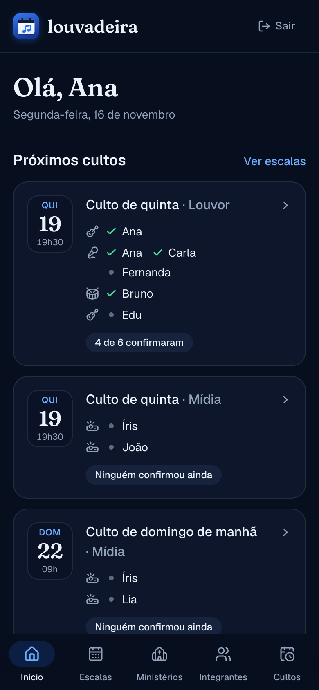
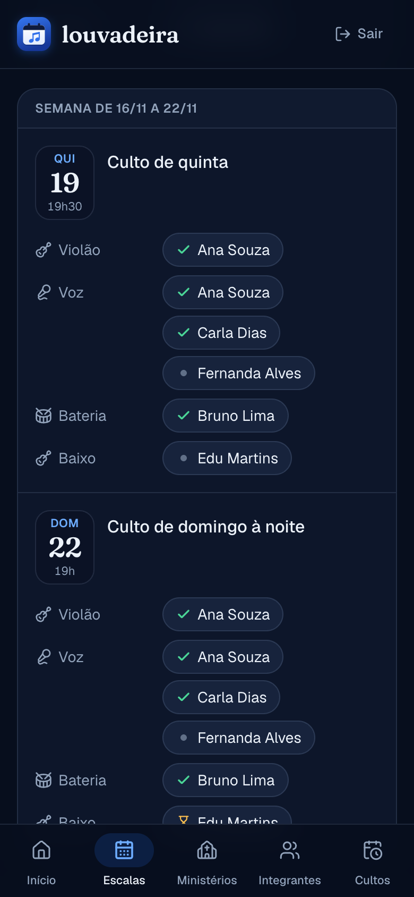
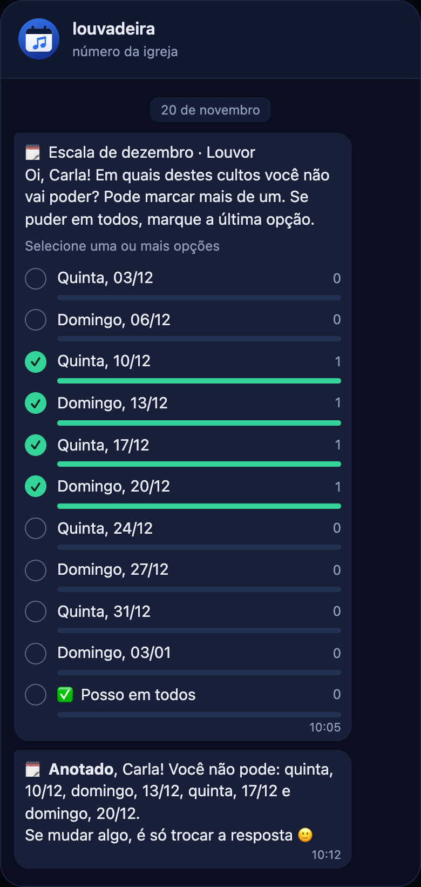

# louvadeira

A louvadeira monta as escalas dos ministérios de uma igreja e resolve o dia a dia pelo WhatsApp: pergunta quem não
pode, publica a escala no grupo, pede confirmação e procura substituto quando alguém avisa que não vai. Os
administradores usam um app web instalável no celular, e a equipe responde enquetes no WhatsApp.

Cada igreja roda a sua própria cópia, em um servidor seu. Os textos do app e das mensagens estão em português do
Brasil, os telefones seguem o formato brasileiro e o vocabulário é o de uma igreja evangélica: culto, ministério,
Santa Ceia.

## Como fica

No app, os administradores acompanham os próximos cultos e a escala, e cada integrante tem a própria página.

<p>
  
  
  
</p>

No WhatsApp, a equipe responde enquetes. As conversas abaixo são ilustrações: os textos e as opções são os que o
bot envia, com pessoas fictícias. No celular, elas aparecem com a aparência do WhatsApp.

<p>
  
  
  
</p>

## O que tem no repositório

| Pasta | O que tem |
| --- | --- |
| `server/` | O servidor em Go: API, banco SQLite, bot do WhatsApp e o app web embutido no binário |
| `web/` | O app web (PWA) em Vite, React, TypeScript e shadcn |
| `deploy/` | Script de instalação por SSH e serviços `systemd` de usuário |
| `docs/` | Esta documentação |

O servidor é um binário só, sem dependências para instalar. [Arquitetura](docs/arquitetura.md) mostra as partes e
como elas conversam.

## Rodar na sua máquina

Você precisa do [mise](https://mise.jdx.dev), que instala Go, Node e pnpm nas versões de `mise.toml`.

```sh
mise install
```

Em um terminal, suba o servidor. Ele atende em `http://localhost:8090` e guarda os dados em `./data`.

```sh
mise run dev:server
```

Em outro terminal, suba o app web, que abre em `http://localhost:5173` e chama o servidor local.

```sh
mise run dev:web
```

O acesso é por link, sem senha. Para entrar, cadastre um administrador e gere um link de acesso:

```sh
cd server
export LOUVADEIRA_DATA_DIR=../data LOUVADEIRA_PUBLIC_URL=http://localhost:5173
mise exec -- go run ./cmd/louvadeira admin add -name "Ana" -phone "(11) 98888-7777"
mise exec -- go run ./cmd/louvadeira admin link -phone "(11) 98888-7777"
```

O segundo comando imprime o link, que vale por 15 minutos e funciona uma vez.

Para rodar os testes do servidor, a checagem de tipos e o lint do app web:

```sh
mise run test
```

## Para onde ir

Para entender o que a louvadeira faz:

- [Como a louvadeira funciona](docs/como-funciona.md) explica o ciclo do mês, como a escala é montada e o que
  acontece quando alguém não pode ir.
- [Mensagens e prazos](docs/mensagens.md) lista cada mensagem que o bot envia, quando e para quem.

Para colocar no ar na sua igreja, nesta ordem:

1. [Instalar em um servidor](docs/instalar-no-servidor.md)
2. [Abrir o app na internet com HTTPS](docs/abrir-na-internet.md)
3. [Conectar o WhatsApp](docs/conectar-o-whatsapp.md)
4. [Montar a primeira escala](docs/montar-a-primeira-escala.md)

Para consultar ou mexer no código:

- [Configuração e comandos](docs/configuracao.md) traz as variáveis de ambiente, os comandos e os arquivos no
  servidor.
- [Arquitetura](docs/arquitetura.md) explica as escolhas do projeto e os riscos de usar o WhatsApp desse jeito.

## Contribuir

Rode `mise run test` antes de enviar uma mudança. As mensagens de commit seguem o padrão
`<tipo>(<escopo>): <assunto>`, como `fix(notify): ...`.

## Licença

O código é distribuído sob a [licença MIT](LICENSE).
