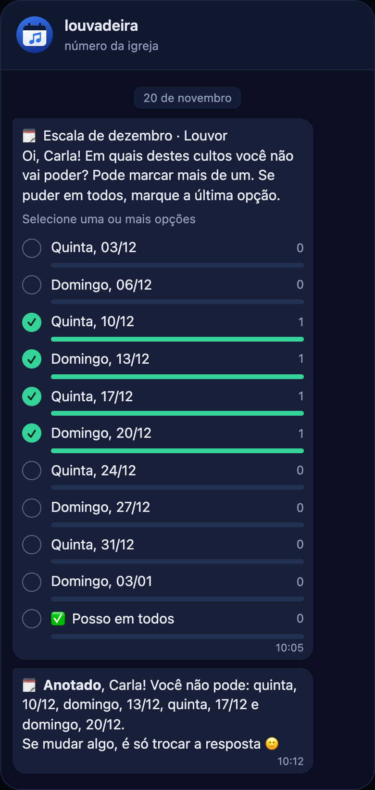
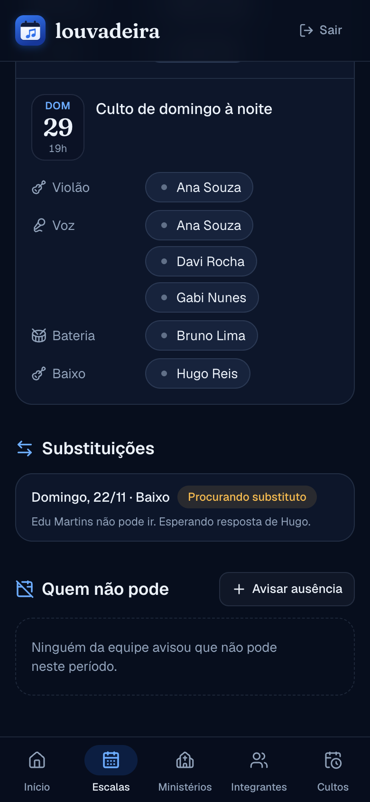
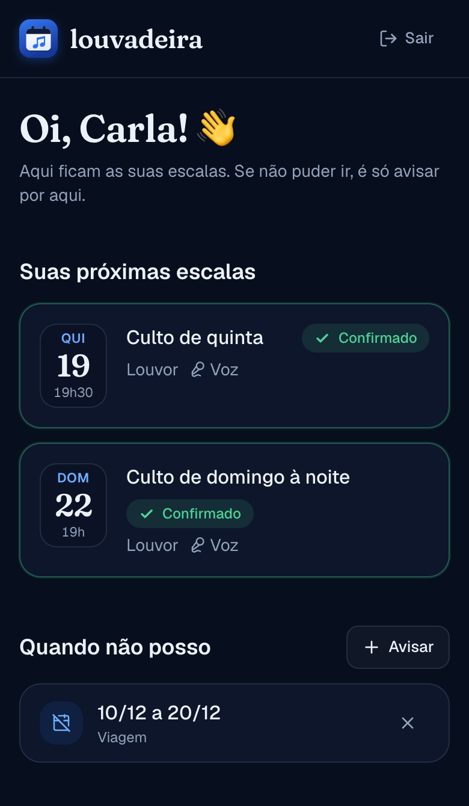

# Como a louvadeira funciona

Os administradores cadastram os cultos, os ministérios e a equipe uma vez. Daí em diante a louvadeira repete o mesmo
ciclo todo mês: pergunta a cada integrante em quais cultos não pode, monta um rascunho com rodízio justo, espera um
líder aprovar e publica a escala no grupo do WhatsApp. Depois pede confirmação de presença e procura substituto
quando alguém avisa que não vai. Tudo isso acontece por enquete no WhatsApp, e a equipe nem precisa abrir o app.

## O que é cadastrado

O app usa as mesmas palavras em todas as telas e mensagens. O código usa os nomes em inglês da última coluna.

| Termo | O que é | No código |
| --- | --- | --- |
| Culto | Um encontro que se repete toda semana, com dia e horário | `services` |
| Ministério | Um grupo de pessoas que serve nos cultos, como louvor, dança ou mídia | `ministries` |
| Função | O que alguém faz no ministério, com um número de vagas por culto | `roles` |
| Integrante | Uma pessoa cadastrada, com nome e WhatsApp | `people` |
| Equipe | Os integrantes de um ministério, cada um com as funções que faz | `ministry_members`, `member_roles` |
| Líder | Integrante da equipe que recebe os avisos do ministério e aprova a escala pelo WhatsApp | `is_leader` |
| Liderança | Os líderes de um ministério. Quando nenhum está marcado, os administradores | |
| Administrador | Integrante que entra no painel do app e mexe nos cadastros e nas escalas | `is_admin` |
| Escala | Quem serve em cada função de cada culto de um mês | `schedules`, `assignments` |
| Ausência | Um dia ou período em que o integrante avisou que não pode | `unavailabilities` |
| Substituição | A procura por alguém para ficar no lugar de quem não pode | `cover_requests` |

Líder e administrador são papéis separados. Um líder que também ajusta a escala no app precisa ser administrador, e
os administradores são criados no servidor, com o comando `admin add` de
[Configuração e comandos](configuracao.md#comandos).

Três escolhas do cadastro mudam o resultado da escala:

- O rodízio do ministério. No rodízio por semana, as mesmas pessoas servem em todos os cultos da semana, de segunda
  a domingo. No rodízio por culto, cada culto tem os seus escalados.
- Quem é fixo em uma função. Um integrante fixo entra em toda escala daquela função e fica fora do rodízio. Os
  outros se revezam nas vagas que sobram.
- A ordem das funções. Quando falta gente, as primeiras funções da lista são preenchidas antes.

Cada função também tem um mínimo de pessoas por culto. Quando a escala publicada fica abaixo dele, a liderança é
avisada três dias antes do culto.

## O ciclo do mês

O ciclo tem duas partes: a rodada do mês, que monta e publica a escala do mês seguinte, e as semanas dos cultos, em
que a louvadeira pede as confirmações.

A rodada começa no dia 20. Cada integrante da equipe recebe no privado uma enquete com os cultos do mês seguinte e
marca aqueles em que não pode. Cada dia marcado vira uma ausência, e quem muda a resposta muda as ausências junto.
Quem não responde continua disponível em todos: só precisa responder quem não pode em algum culto.

Três dias depois do início, a louvadeira monta o rascunho e manda o resumo aos líderes, com uma enquete para
aprovar. Se um administrador já tiver começado um rascunho no app, esse rascunho é mantido como está. Aprovada pela
enquete ou publicada pelo app, a escala sai no grupo do ministério. A mensagem menciona os escalados do rodízio, e
os fixos ficam subentendidos.

Na ordem: a enquete que cada integrante recebe, o que chega para o líder e a escala publicada no grupo.

  
  
  

As conversas são ilustrações: os textos e as opções são os que o bot envia, com pessoas fictícias. No celular,
elas aparecem com a aparência do WhatsApp.

Uma escala publicada não é gerada de novo. A partir da publicação, toda mudança é uma substituição ou um ajuste
feito à mão no app.

Em cada semana da escala, a louvadeira pede confirmação sete dias antes do primeiro culto. Dois dias antes de cada
culto, publica a escala dele no grupo do ministério, marcando quem serve. No rodízio por semana, uma única enquete
cobre todos os cultos da semana.
[Mensagens e prazos](mensagens.md) traz a lista completa, com horários e destinatários.

  

## Como a escala é montada

O gerador preenche um bloco de cultos por vez: a semana inteira no rodízio por semana, ou um culto no rodízio por
culto. Uma semana pertence ao mês do primeiro culto dela. A quinta-feira do dia 31 e o domingo seguinte, por
exemplo, ficam na mesma escala.

Dentro de cada bloco, as funções são preenchidas na ordem do cadastro. Para cada função, o gerador:

1. Coloca os integrantes fixos que estão disponíveis.
2. Escolhe, entre quem pode em todos os cultos do bloco, as pessoas do rodízio com o menor custo, explicado abaixo.
3. Completa culto a culto as vagas que sobraram, com quem pode naquele culto.
4. Deixa a vaga como "Vago" quando ninguém pode, e avisa na revisão do rascunho.

Cada pessoa faz uma função por culto. A exceção é quem é fixo em mais de uma função, que faz todas juntas, como
alguém que toca violão e canta.

O custo de uma escolha é a soma de quatro critérios, com os pesos definidos em
`server/internal/schedule/generate.go`:

| Critério | Peso | Efeito |
| --- | --- | --- |
| Vezes que a pessoa serviu nas últimas 8 semanas | 10 por vez | Quem serviu menos entra primeiro |
| Serviu no bloco anterior | 6 | Evita duas semanas seguidas |
| Vezes que a dupla já serviu junta na função | 8 por vez | As duplas vão mudando |
| Mesma dupla do bloco anterior | 40 | Repetir a dupla da semana passada é quase proibido |

No empate, entra quem está há mais tempo sem servir. Repetir uma dupla custa mais do que servir duas semanas
seguidas. Por isso as duplas variam ao longo dos meses, mesmo que às vezes alguém sirva em duas semanas seguidas.

O histórico vem das escalas publicadas, e as substituições entram nele. Quem cobriu um culto fica mais atrás na fila
do mês seguinte e quem saiu fica mais à frente, sem regra extra.

## Quando alguém não pode ir

O integrante avisa de um destes jeitos: responde "Não vou conseguir" na enquete de confirmação, manda no privado
"não posso" seguido do dia, ou avisa na própria página do app. Um administrador também pode marcar a ausência de
alguém pelo painel.

A louvadeira então chama no privado, todos ao mesmo tempo, os integrantes que podem substituir: quem tem a mesma
função na equipe e tem WhatsApp, não está naquele culto e não avisou ausência naquele dia. O primeiro que aceita
fica com o lugar, já confirmado. Quem avisou continua na escala até alguém aceitar. Assim nenhuma vaga fica aberta
sem que alguém esteja resolvendo.

O convite que o substituto recebe, e a substituição em andamento vista no painel:

  
  

A liderança é avisada sempre. Quando faltam menos de 72 horas para o culto, o aviso diz isso, e o painel marca a
substituição como "Em cima da hora". Quando alguém aceita, a mudança é anunciada no grupo do ministério. Se ninguém
da equipe está livre, ou se todos recusam, a liderança recebe o pedido de ajuda, e um administrador ajusta a escala
no app.

Quem avisou que não ia pode voltar atrás enquanto ninguém tiver aceitado o lugar. Depois disso, a volta passa pela
liderança.

O motivo de uma ausência (viagem, trabalho, saúde, família, estudos ou outro) aparece só para os administradores e
para a liderança.

## Quando falta gente em um culto

Três dias antes de um culto, se alguma função está abaixo do mínimo e ainda há alguém livre na equipe, cada líder
recebe uma enquete com três saídas: seguir assim, pedir no grupo ou ajustar no app. Se o líder escolhe pedir no
grupo, a louvadeira publica lá uma enquete com as funções em falta, e o primeiro integrante que responder entra na
escala.

## Como as pessoas entram no app

O app não tem senha. O integrante digita o seu WhatsApp na tela de entrada e recebe pelo WhatsApp um link de acesso.
O link funciona uma vez e deixa o celular conectado. Administradores caem no painel, com escalas e cadastros. Os
outros integrantes veem a própria página, com as suas escalas e os dias em que não podem.

  
  

## Para saber mais

- [Mensagens e prazos](mensagens.md) lista cada mensagem, os horários e os comandos que o bot entende.
- [Montar a primeira escala](montar-a-primeira-escala.md) mostra a ordem dos cadastros no app.
- [Arquitetura](arquitetura.md) explica as partes do servidor e os riscos de usar o WhatsApp desse jeito.

Voltar ao [início](../README.md).
