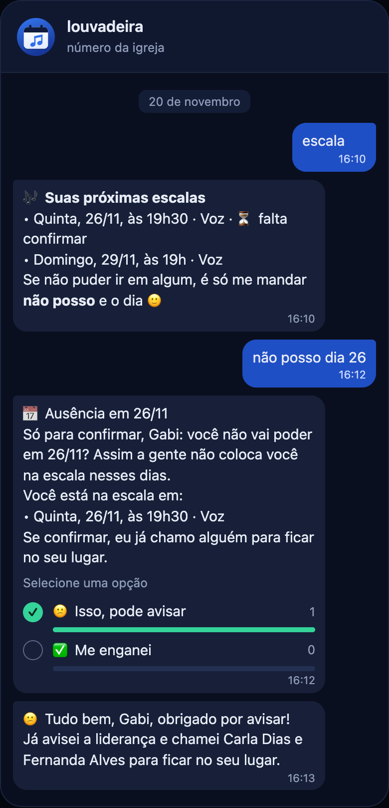

# Mensagens e prazos

Cada mensagem que a louvadeira envia no WhatsApp, com o momento em que sai e quem recebe. Os prazos são constantes
no código, em `server/internal/notify/`, e valem para todos os ministérios.

## Horário de envio

| Regra | Valor |
| --- | --- |
| Janela das mensagens agendadas | Das 8h às 21h, no fuso de `LOUVADEIRA_TIMEZONE` |
| Frequência da verificação | A cada 5 minutos, com o WhatsApp conectado |
| Pausa entre duas mensagens | De 2 a 5 segundos, aleatória |
| Respostas a enquetes e comandos | Na hora, a qualquer horário |
| Espera depois de um voto | 20 segundos, para contar só a última resposta de quem muda de ideia |

Cada mensagem agendada sai uma vez. Depois de uma parada, o servidor envia o que ficou para trás e não repete o que
já foi enviado. Uma mensagem interrompida no meio do envio, por um reinício ou uma queda de energia, sai de novo.

## Rodada do mês

A rodada trata da escala do mês seguinte e roda para cada ministério que ainda não tem esse mês publicado.

| Quando | Para quem | Mensagem |
| --- | --- | --- |
| Dia 20, a partir das 10h | Cada integrante da equipe com WhatsApp | Enquete de várias escolhas com os cultos do mês e a opção "✅ Posso em todos" |
| 48 horas depois do início | Quem recebeu a enquete e não respondeu | Lembrete para responder |
| 72 horas depois do início | Cada líder do ministério | Resumo do rascunho e a enquete "✅ Pode publicar" ou "✏️ Vou ajustar no app" |
| Ao publicar, pela enquete ou pelo app | Grupo do ministério | A escala do mês, mencionando os escalados do rodízio. Os fixos ficam subentendidos |

Uma enquete do WhatsApp aceita 12 opções. Um mês com mais de 11 cultos é dividido em mais de uma enquete.

Se a escala publicada não chega ao grupo porque o envio falhou, o líder que aprovou fica sabendo, e o bot tenta de
novo a cada verificação até o fim do mês.

## Semana do culto

| Quando | Para quem | Mensagem |
| --- | --- | --- |
| 7 dias antes do primeiro culto da semana, a partir das 18h | Cada escalado que ainda não confirmou | Enquete de confirmação |
| 2 dias antes do culto, a partir das 18h | Grupo do ministério, marcando quem serve | A escala do culto: quem serve em cada função e as funções sem ninguém |
| 2 dias antes do culto, a partir das 18h, em ministério sem grupo | Cada escalado que não avisou ausência | "Você está na escala", com a função |
| A partir de 3 dias antes do culto, depois das 9h | Cada líder | "Falta responder", com os nomes de quem recebeu a enquete há mais de 24 horas e não respondeu |
| A partir de 3 dias antes do culto, depois das 9h | Cada líder | Enquete sobre o culto com função abaixo do mínimo: "✅ Segue assim", "📣 Pedir no grupo" ou "✏️ Vou ajustar no app" |

A confirmação e o lembrete saem às 18h: a equipe já saiu do trabalho e ainda não está em um culto da noite. O
lembrete sai dois dias antes para que um ensaio na véspera, como o de sábado para o culto de domingo, já esteja
avisado. A marcação no grupo notifica quem serve mesmo com o grupo silenciado.

No rodízio por culto, a confirmação é pedida 7 dias antes de cada culto.

As opções da enquete de confirmação dependem de quantos cultos ela cobre:

| Cultos na enquete | Opções |
| --- | --- |
| 1 | "✅ Vou estar lá" e "😕 Não vou conseguir" |
| 2 ou mais | "✅ Vou nos dois" ou "✅ Vou em todos", uma opção "😕 Não consigo" para cada dia, e "😕 Não consigo em nenhum" |

Marcar "😕 Não consigo" em um dia confirma a presença nos outros dias da enquete. Quem troca a resposta de um dia para
outro volta para a escala do primeiro dia, desde que ninguém tenha aceitado o lugar.

## Substituições

| Quando | Para quem | Mensagem |
| --- | --- | --- |
| Alguém avisa que não vai | Cada integrante que pode substituir | Enquete com os cultos que a pessoa pode assumir |
| Alguém avisa que não vai | Cada líder | Aviso da ausência, com quem foi chamado. Vem com ⏰ a menos de 72 horas do culto |
| Alguém aceita | Quem aceitou e quem saiu | Confirmação do lugar e a notícia da troca |
| Alguém aceita | Grupo do ministério, ou os líderes quando não há grupo | "Mudança na escala" |
| Todos os chamados recusam | Cada líder | "Ninguém conseguiu substituir" |
| Quem saiu volta atrás | Cada líder e quem ainda estava convidado | Aviso de que a pessoa vai, afinal |
| Um líder escolhe "📣 Pedir no grupo" | Grupo do ministério | Enquete com uma opção "🙋 Eu posso" por função em falta |

Um convite que não pôde ser enviado é tentado de novo a cada verificação, das 8h às 21h, por até 24 horas, mesmo
que outras pessoas já tenham recebido o delas. Depois disso, ele conta como recusa: se ninguém mais aceitar, os
líderes recebem o pedido de ajuda.

Uma resposta a enquete que chega ao servidor depois que o culto começou, porque ele estava fora do ar, não muda a
escala desse culto e não gera mensagens.

## Comandos no privado

O bot responde a integrantes cadastrados, quando a mensagem é um dos comandos abaixo. O número pode continuar a
receber conversas comuns, que ficam sem resposta e sem registro.

| Mensagem | O que o bot faz |
| --- | --- |
| `ajuda`, `menu` ou `comandos` | Lista os comandos |
| `escala`, `escalas` ou `minha escala` | Mostra os cultos da pessoa nos próximos 28 dias |
| `não posso`, sem dia | Vale como resposta a uma enquete recebida nas últimas 48 horas. Sem enquete recente, pergunta em qual culto a pessoa não vai |
| `não posso dia 19`, `não posso 19/11`, `não posso domingo`, `não posso amanhã` | Confirma por enquete e registra a ausência naquele dia |
| `não posso de 10/12 a 20/12`, `não posso até 20/12` | Confirma por enquete e registra a ausência no período |
| `sim`, `não` e respostas curtas como `vou`, `confirmo` ou `não vou`, até 48 horas depois de uma enquete | Vale como resposta à última enquete recebida, quando ela é de sim ou não. Se a última enquete tem várias escolhas, o bot pede para marcar na enquete |

O bot também entende `não vou poder`, `não vou conseguir` e `não consigo` no lugar de `não posso`. Acentos e
maiúsculas não fazem diferença. Uma data sem ano, ou um dia sem mês, significa a próxima vez que aquele dia chega.

Uma mensagem que chega mais de 2 horas depois de enviada, porque o servidor estava fora do ar, fica sem resposta.

Uma conversa com dois comandos. A imagem é uma ilustração: os textos e as opções são os que o bot envia, com pessoas fictícias. No celular,
a conversa aparece com a aparência do WhatsApp.

  

## Acesso ao app

| Mensagem | Quando | Validade |
| --- | --- | --- |
| Link de acesso | O integrante pede na tela de entrada, ou um administrador envia pela ficha do integrante | 1 hora, um uso |

Enquanto o último link ainda vale, um novo pedido na tela de entrada não envia outro. No modo de teste, o link só
chega a números da lista de permissão.

Voltar para [Como a louvadeira funciona](como-funciona.md).
